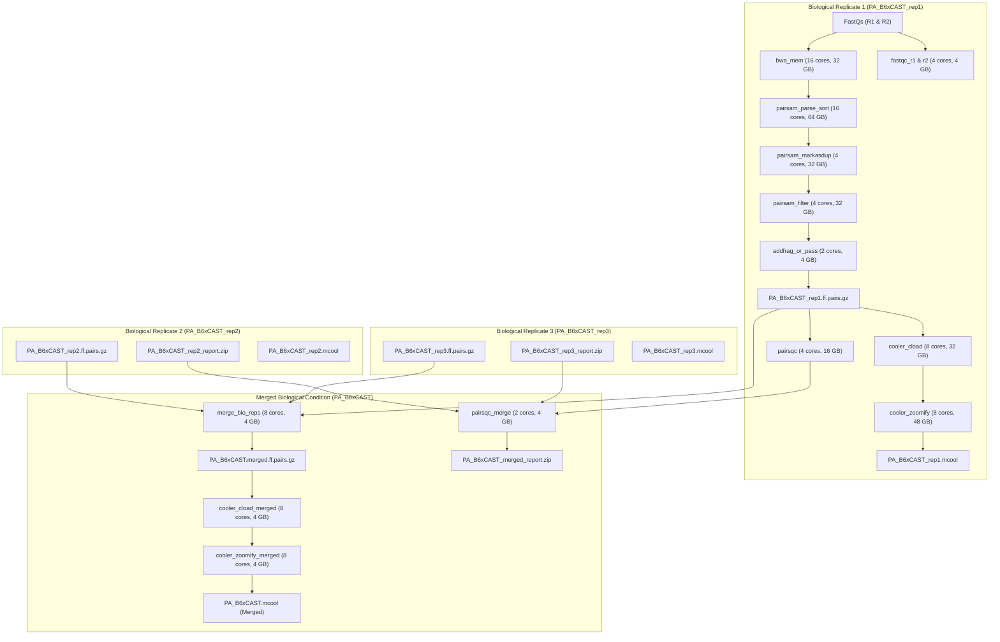

# Dry-Run Execution Trace: PA_B6xCAST (BioRep1, BioRep2, BioRep3 & Merged)

This document details the exact execution steps, Slurm resource allocations, and shell commands extracted from `dry_run.txt` for the condition **`PA_B6xCAST`**.

---

## 1. Summary of Execution DAG for `PA_B6xCAST`



---

## 2. Step-by-Step Parameter & Shell Command Verification

### Step 0: Reference Chromosome Sizes Generation
* **Rule**: `generate_chrom_sizes`
* **Input**: `/archive/cbds/idx/ensembl/Mus_musculus/GRCm39/sequence_only/bwa/0.7.18/genome.ann`
* **Output**: `results/reference/chrom.sizes`
* **Resources**: 1 thread, 4 GB RAM, 120 min
* **Command**:
  ```bash
  awk 'NR%2==0 {name=$2} NR%2!=0 && NR>1 {print name"\t"$2}' \
      /archive/cbds/idx/ensembl/Mus_musculus/GRCm39/sequence_only/bwa/0.7.18/genome.ann | \
      sort -k1,1 -V > results/reference/chrom.sizes
  ```

---

### Step 1: Read Quality Control (FastQC)
* **Rules**: `fastqc_r1` and `fastqc_r2`
* **Inputs**:
  - `../FASTQs/no_SRA_standard_download_available/data/processed/PA_B6xCAST_BioRep1_R1.fastq.gz`
  - `../FASTQs/no_SRA_standard_download_available/data/processed/PA_B6xCAST_BioRep1_R2.fastq.gz`
* **Outputs**:
  - `results/qc/fastqc/PA_B6xCAST_rep1_1_R1_fastqc.zip`, `.html`
  - `results/qc/fastqc/PA_B6xCAST_rep1_1_R2_fastqc.zip`, `.html`
* **Resources**: 4 threads, 4 GB RAM, 120 min
* **Command**:
  ```bash
  /usr/local/bin/run-fastqc.sh \
      ../FASTQs/no_SRA_standard_download_available/data/processed/PA_B6xCAST_BioRep1_R1.fastq.gz \
      4 results/qc/fastqc/tmp_PA_B6xCAST_rep1_1_R1
  ```

---

### Step 2: Alignment (BWA-MEM)
* **Rule**: `bwa_mem`
* **Inputs**: FastQ R1, FastQ R2, BWA index directory
* **Output**: `results/bam/PA_B6xCAST_rep1_1.bam`
* **Resources**: 16 threads, 32 GB RAM, 720 min (12h)
* **Command**:
  ```bash
  bwa mem -t 16 -SP5M \
      "/archive/cbds/idx/ensembl/Mus_musculus/GRCm39/sequence_only/bwa/0.7.18" \
      ../FASTQs/no_SRA_standard_download_available/data/processed/PA_B6xCAST_BioRep1_R1.fastq.gz \
      ../FASTQs/no_SRA_standard_download_available/data/processed/PA_B6xCAST_BioRep1_R2.fastq.gz 2> results/logs/bwa_mem/PA_B6xCAST_rep1_1.log | \
      samtools view -Shb - > results/bam/PA_B6xCAST_rep1_1.bam 2>> results/logs/bwa_mem/PA_B6xCAST_rep1_1.log
  ```

---

### Step 3: Pairsam Parse & Sort
* **Rule**: `pairsam_parse_sort`
* **Inputs**: `results/bam/PA_B6xCAST_rep1_1.bam`, `results/reference/chrom.sizes`
* **Output**: `results/pairsam/PA_B6xCAST_rep1_1.sam.pairs.gz`
* **Resources**: 16 threads, 64 GB RAM, 720 min (12h)
* **Command**:
  ```bash
  /usr/local/bin/run-pairsam-parse-sort.sh \
      results/bam/PA_B6xCAST_rep1_1.bam \
      results/reference/chrom.sizes \
      results/pairsam \
      PA_B6xCAST_rep1_1 \
      16 \
      gzip > results/logs/pairtools/parse_sort_PA_B6xCAST_rep1_1.log 2>&1
  ```

---

### Step 4: Duplicate Marking
* **Rule**: `pairsam_markasdup`
* **Input**: `results/pairsam/PA_B6xCAST_rep1_1.sam.pairs.gz`
* **Outputs**: `results/pairsam_marked/PA_B6xCAST_rep1.marked.sam.pairs.gz`, `.px2`
* **Resources**: 4 threads, 32 GB RAM, 480 min (8h)
* **Command**:
  ```bash
  /usr/local/bin/run-pairsam-markasdup.sh \
      results/pairsam/PA_B6xCAST_rep1_1.sam.pairs.gz \
      results/pairsam_marked/PA_B6xCAST_rep1 > results/logs/pairtools/markasdup_PA_B6xCAST_rep1.log 2>&1
  ```

---

### Step 5: Filtering & Lossless BAM Retention
* **Rule**: `pairsam_filter`
* **Inputs**: `results/pairsam_marked/PA_B6xCAST_rep1.marked.sam.pairs.gz`, `results/reference/chrom.sizes`
* **Outputs**:
  - `results/pairs_filtered/PA_B6xCAST_rep1.dedup.pairs.gz`, `.px2`
  - `results/bam_lossless/PA_B6xCAST_rep1.lossless.bam`
* **Resources**: 4 threads, 32 GB RAM, 480 min (8h)
* **Command**:
  ```bash
  /usr/local/bin/run-pairsam-filter.sh \
      results/pairsam_marked/PA_B6xCAST_rep1.marked.sam.pairs.gz \
      results/pairs_filtered/PA_B6xCAST_rep1 \
      results/reference/chrom.sizes > results/logs/pairtools/filter_PA_B6xCAST_rep1.log 2>&1
  ```

---

### Step 6: Micro-C Fragment Handling
* **Rule**: `addfrag_or_pass`
* **Input**: `results/pairs_filtered/PA_B6xCAST_rep1.dedup.pairs.gz`
* **Outputs**: `results/pairs/PA_B6xCAST_rep1.ff.pairs.gz`, `.px2`
* **Resources**: 2 threads, 4 GB RAM, 120 min
* **Command**:
  ```bash
  /usr/local/bin/run-addfrag2pairs.sh \
      -i results/pairs_filtered/PA_B6xCAST_rep1.dedup.pairs.gz \
      -o results/pairs/PA_B6xCAST_rep1 > results/logs/pairtools/addfrag_PA_B6xCAST_rep1.log 2>&1
  ```

---

### Step 7: Individual Biological Replicate QC (pairsqc)
* **Rule**: `pairsqc`
* **Inputs**: `results/pairs/PA_B6xCAST_rep1.ff.pairs.gz`, `results/reference/chrom.sizes`
* **Output**: `results/qc/pairsqc/PA_B6xCAST_rep1_report.zip`
* **Resources**: 4 threads, 16 GB RAM, 240 min (4h)
* **Command**:
  ```bash
  /usr/local/bin/run-pairsqc-single.sh \
      results/pairs/PA_B6xCAST_rep1.ff.pairs.gz \
      results/reference/chrom.sizes \
      PA_B6xCAST_rep1 \
      4 \
      results/qc/pairsqc \
      8.4 > results/logs/pairsqc/PA_B6xCAST_rep1.log 2>&1
  ```

---

### Step 8: Individual Contact Matrix Generation (.cool & .mcool)
* **Rules**: `cooler_cload` and `cooler_zoomify`
* **Outputs**:
  - `results/cool/PA_B6xCAST_rep1.cool` (1 kb base resolution)
  - `results/mcool/PA_B6xCAST_rep1.mcool` (Multi-resolution: 1kb to 10Mb)
* **Resources**: 8 threads, 32 GB to 48 GB RAM, 480 min (8h)
* **Commands**:
  ```bash
  # Cooler cload (1kb binning)
  /usr/local/bin/run-cooler.sh \
      results/pairs/PA_B6xCAST_rep1.ff.pairs.gz \
      results/reference/chrom.sizes \
      1000 \
      8 \
      results/cool/PA_B6xCAST_rep1 \
      2 > results/logs/cooler/cload_PA_B6xCAST_rep1.log 2>&1

  # Cooler zoomify (Multi-resolution pyramid + balancing)
  /usr/local/bin/run-cool2multirescool.sh \
      -i results/cool/PA_B6xCAST_rep1.cool \
      -o results/mcool/PA_B6xCAST_rep1 \
      -p 8 \
      -c 10000000 \
      -u 1000,2000,5000,10000,25000,50000,100000,250000,500000,1000000,2500000,5000000,10000000 > results/logs/cooler/zoomify_PA_B6xCAST_rep1.log 2>&1
  ```

---

### Step 9: Merging Biological Replicates 1, 2, and 3
* **Rule**: `merge_bio_reps` (Official 4DN `merge-pairs.cwl`)
* **Inputs**:
  - `results/pairs/PA_B6xCAST_rep1.ff.pairs.gz`
  - `results/pairs/PA_B6xCAST_rep2.ff.pairs.gz`
  - `results/pairs/PA_B6xCAST_rep3.ff.pairs.gz`
* **Outputs**: `results/pairs_merged/PA_B6xCAST.merged.ff.pairs.gz`, `.px2`
* **Resources**: 8 threads, 4 GB RAM, 120 min
* **Command**:
  ```bash
  /usr/local/bin/run-merge-pairs.sh \
      results/pairs_merged/PA_B6xCAST.merged.ff \
      results/pairs/PA_B6xCAST_rep1.ff.pairs.gz \
      results/pairs/PA_B6xCAST_rep2.ff.pairs.gz \
      results/pairs/PA_B6xCAST_rep3.ff.pairs.gz > results/logs/pairtools/merge_bioreps_PA_B6xCAST.log 2>&1
  ```

---

### Step 10: Merged Contact Matrix Generation
* **Rules**: `cooler_cload_merged` and `cooler_zoomify_merged`
* **Outputs**:
  - `results/cool_merged/PA_B6xCAST.cool`
  - `results/mcool_merged/PA_B6xCAST.mcool`
* **Resources**: 8 threads, 4 GB to 48 GB RAM, 120-480 min
* **Commands**:
  ```bash
  # Merged Cooler Cload
  /usr/local/bin/run-cooler.sh \
      results/pairs_merged/PA_B6xCAST.merged.ff.pairs.gz \
      results/reference/chrom.sizes \
      1000 \
      8 \
      results/cool_merged/PA_B6xCAST \
      2 > results/logs/cooler/cload_merged_PA_B6xCAST.log 2>&1

  # Merged Cooler Zoomify
  /usr/local/bin/run-cool2multirescool.sh \
      -i results/cool_merged/PA_B6xCAST.cool \
      -o results/mcool_merged/PA_B6xCAST \
      -p 8 \
      -c 10000000 \
      -u 1000,2000,5000,10000,25000,50000,100000,250000,500000,1000000,2500000,5000000,10000000 > results/logs/cooler/zoomify_merged_PA_B6xCAST.log 2>&1
  ```

---

### Step 11: Merged Biological Replicate QC (pairsqc-merge)
* **Rule**: `pairsqc_merge` (Official 4DN `pairsqc-merge.cwl`)
* **Inputs**:
  - `results/qc/pairsqc/PA_B6xCAST_rep1_report.zip`
  - `results/qc/pairsqc/PA_B6xCAST_rep2_report.zip`
  - `results/qc/pairsqc/PA_B6xCAST_rep3_report.zip`
* **Output**: `results/qc/pairsqc_merged/PA_B6xCAST_merged_report.zip`
* **Resources**: 2 threads, 4 GB RAM, 120 min
* **Command**:
  ```bash
  /usr/local/bin/run-pairsqc-merge.sh \
      results/qc/pairsqc_merged \
      PA_B6xCAST_merged \
      4 \
      results/qc/pairsqc/PA_B6xCAST_rep1_report.zip \
      results/qc/pairsqc/PA_B6xCAST_rep2_report.zip \
      results/qc/pairsqc/PA_B6xCAST_rep3_report.zip > results/logs/pairsqc/merge_PA_B6xCAST.log 2>&1
  ```

---

## 3. Parameter & Workflow Health Check

| Check Item | Verified Status | Details |
| :--- | :--- | :--- |
| **BWA Index Resolution** | ✅ PASSED | Directly utilizes `/archive/cbds/idx/.../bwa/0.7.18` with zero redundant tar extraction |
| **Chromosome Sizes** | ✅ PASSED | Automatically parsed from BWA `genome.ann` |
| **Deduplication Tier** | ✅ PASSED | `rep1`, `rep2`, `rep3` deduplicated independently before merging |
| **Biological Merging** | ✅ PASSED | Merged using official 4DN multi-stream `run-merge-pairs.sh` |
| **Matrix Resolutions** | ✅ PASSED | Base resolution 1000 bp, pyramids 1kb to 10Mb, ICE balanced |
| **Quality Control** | ✅ PASSED | FastQC on all FastQs, individual pairsqc, and merged pairsqc report |
| **Resource Allocations** | ✅ PASSED | Slurm CPUs & RAM appropriately matched to job intensities (up to 64GB for pairtools parse/sort) |
